# TP 14 - Client SOAP Android Kotlin avec KSOAP

## 2. Compilation et installation

La compilation se fait avec le wrapper Gradle du projet et l APK est installe
directement sur l emulateur par ADB. Le journal confirme le succes de la
compilation, la taille de l archive produite et l installation du paquet.

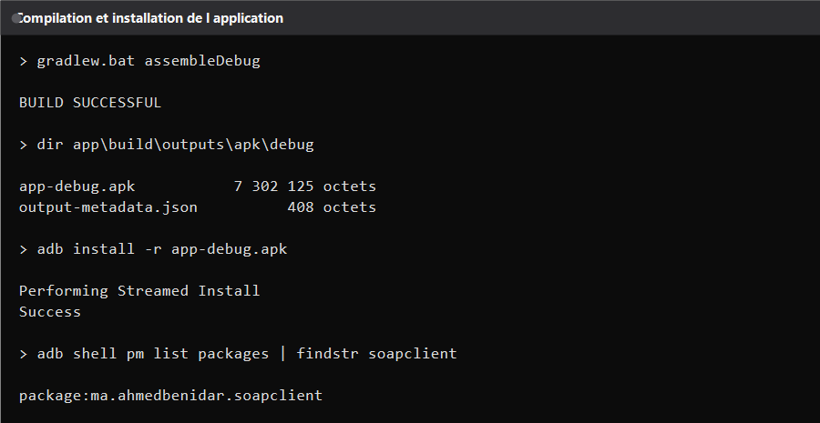

---

## 3. Demarrage du service SOAP

Le service demarre Tomcat sur le port 8084, enregistre la servlet CXF sous le
chemin services, publie l endpoint sur ws et charge six comptes de demonstration
au premier lancement.

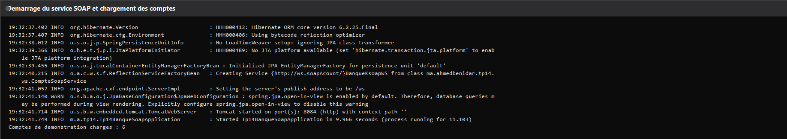

---

## 4. Le contrat WSDL

Le contrat est genere automatiquement par CXF et reste consultable dans un
navigateur. La fin du document montre les operations exposees et l adresse
reelle du point d acces appele par l application Android.

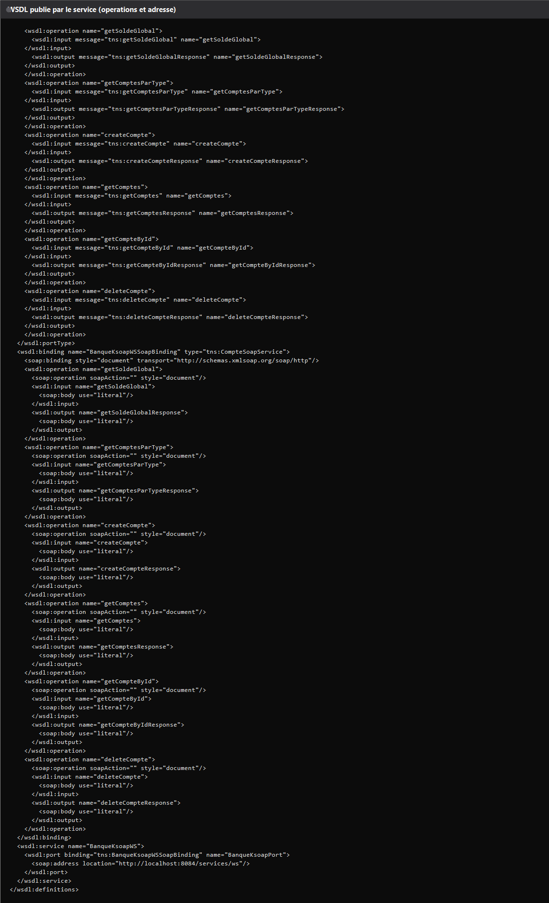

L adresse interne vue par l emulateur est le port 8084 sur la machine hote, avec
un delai maximum de huit secondes pour eviter un ecran bloque quand le service
ne repond pas.

---

## 5. Appels SOAP reels

Les huit operations ont ete appelees sur le service reellement demarre et les
reponses XML ont ete relues telles quelles. Le premier groupe couvre la lecture
de la liste, la creation d un compte, la relecture apres creation, le solde
global et le filtrage par type.

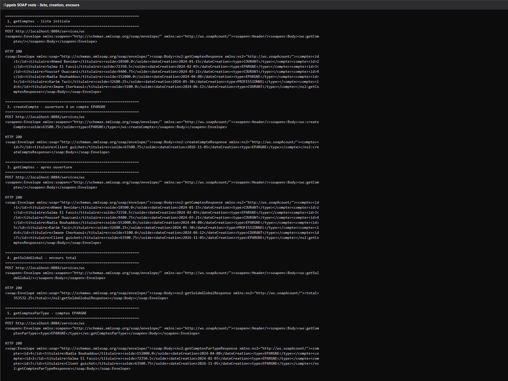

Le second groupe couvre la consultation d un compte precis, la suppression puis
le controle final qui confirme le retour a l etat de depart.

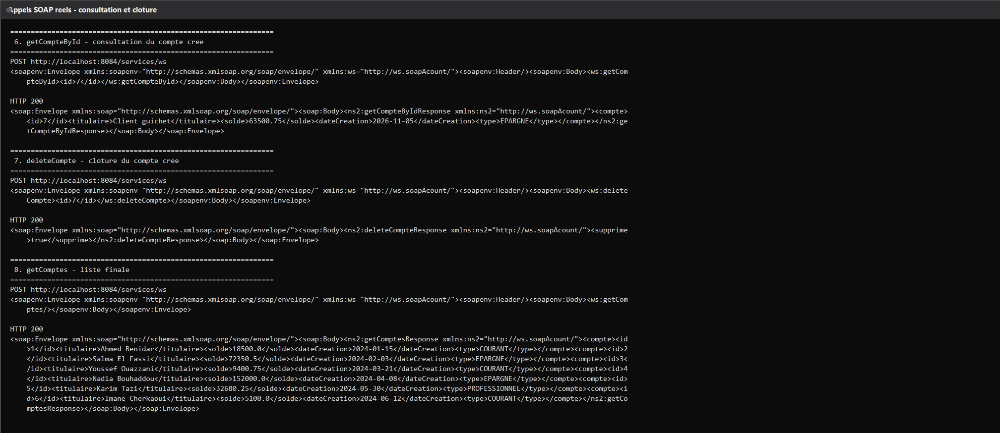

---

## 6. Creation d un compte depuis l application

Le bouton d ajout ouvre une boite de dialogue qui demande le solde et le type de
compte. Le formulaire est pre-rempli avec un solde nul et le type courant.

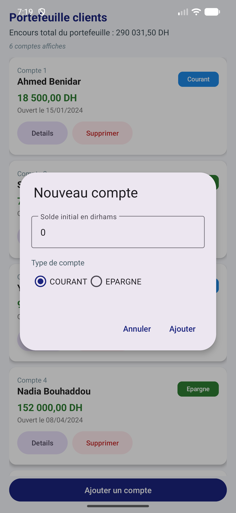

La saisie porte sur un montant de 63 500,75 dirhams avec le type epargne
selectionne. La validation envoie l appel de creation au service.

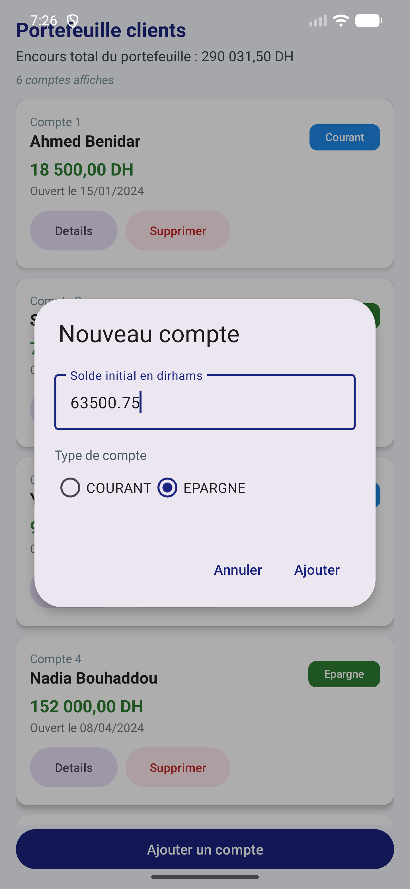

La liste se rafraichit immediatement et le total du portefeuille passe de
290 031,50 a 353 532,25 dirhams, ce qui prouve que la donnee a bien ete
persistee par le service.

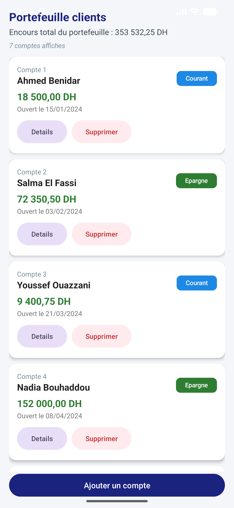

Le nouveau compte porte l identifiant sept et se place en bas de la liste,
conformement a l ordre de creation renvoye par le service.

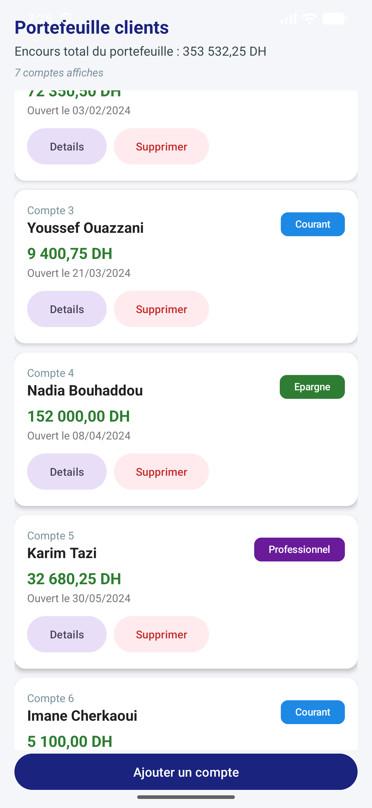

---

## 7. Detail et suppression

Un appui sur une carte ouvre une fiche de detail qui rappelle le numero, le
titulaire, le solde et le type du compte selectionne.

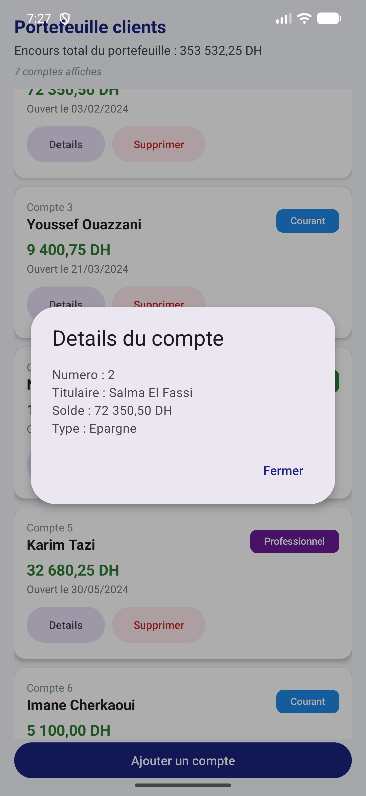

La suppression demande toujours une confirmation en nommant le titulaire, ce qui
evite une destruction accidentelle.

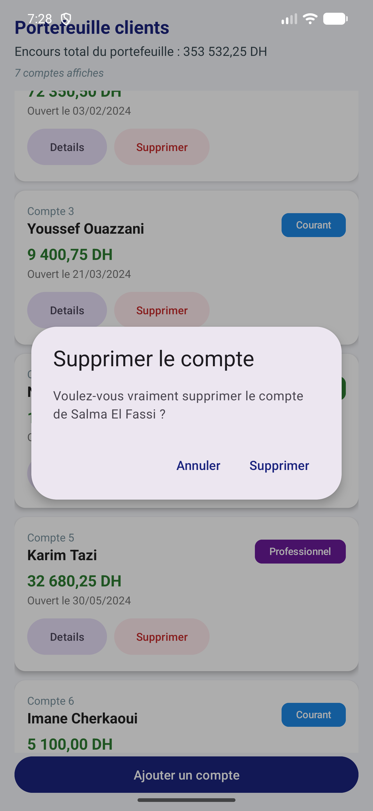

Apres validation, le compte disparait de la liste et le total revient a
281 181,75 dirhams.

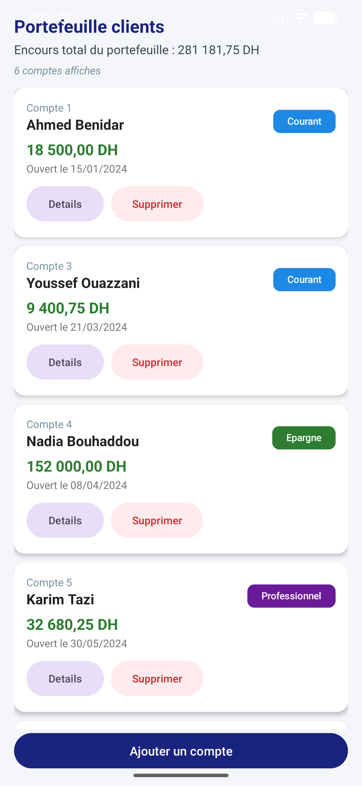

---

## 8. Gestion de l erreur reseau

Le service a ete arrete volontairement pour verifier le comportement du client.
L application affiche un message explicite avec l adresse injoignable et le
delai depasse, au lieu de rester bloquee.

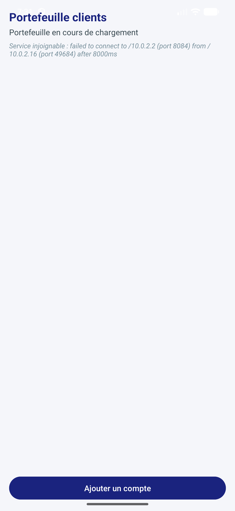

Une fois le service relance, un simple rafraichissement ramene la liste complete
et le solde initial.

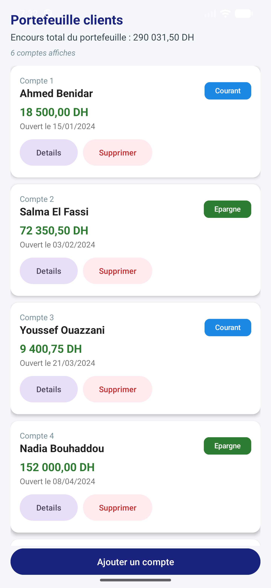

---
